# Evidencia visual F1

Capturas de Chromium sobre el build estático. Cada fila empareja el componente implementado con su referencia, abierta por HTTP local sin conexiones externas. Se capturan los estados finales de las animaciones; los e2e verifican por separado las duraciones y el modo reducido.

| Estado y ancho | Sitio | Maqueta equivalente |
|---|---|---|
| Hero · 1280 |  | 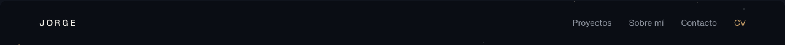 |
| Hero · 834 |  |  |
| Hero · 390 |  |  |
| Fija · 1280 | 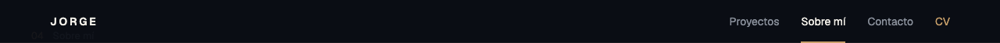 | 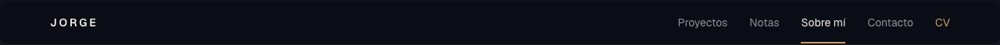 |
| Fija · 834 | 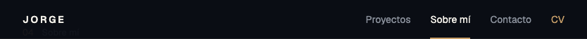 |  |
| Fija · 390 | 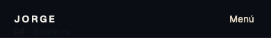 |  |
| Artículo · 1280 | 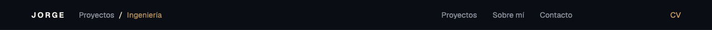 |  |
| Artículo · 834 |  |  |
| Artículo · 390 | 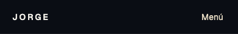 |  |
| Menú · 1280 (estado forzado) | 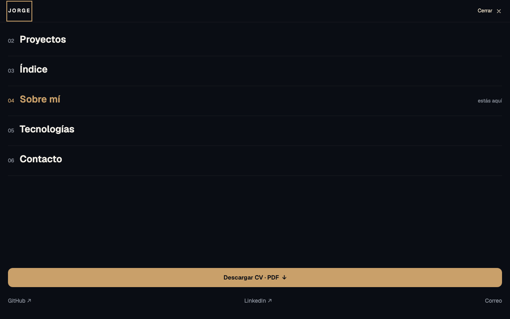 | 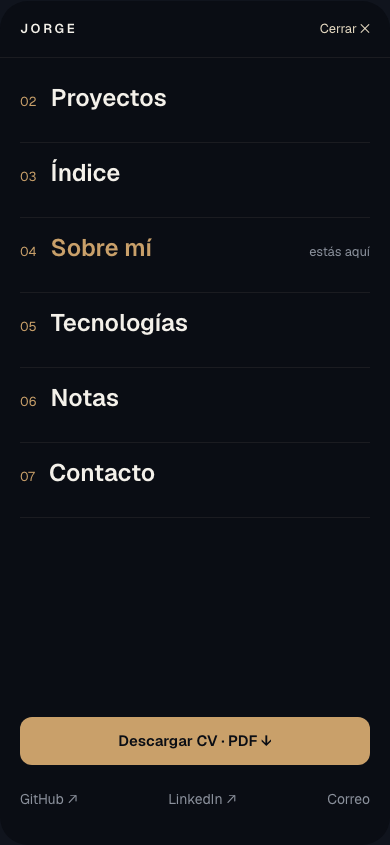 |
| Menú · 834 (estado forzado) | 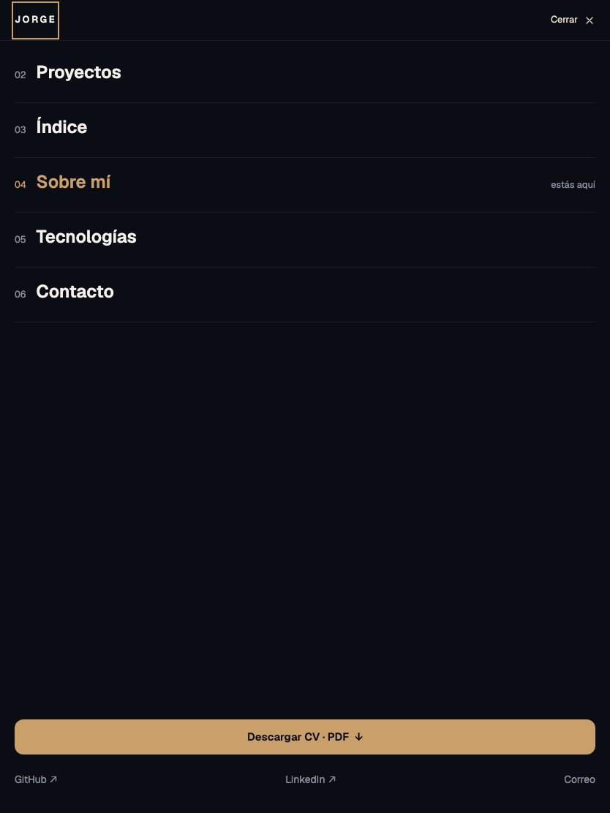 |  |
| Menú · 390 | 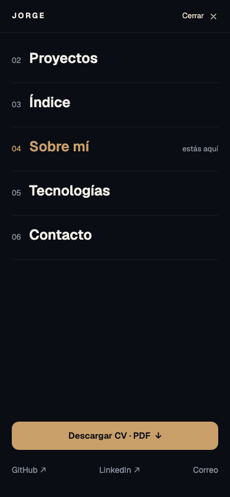 |  |

El menú se ofrece únicamente por debajo de 768 px: la Maqueta 1 mantiene navegación de escritorio a 834. Para documentar el componente a 1280 y 834, el script abre el diálogo directamente; esas dos imágenes no representan un botón disponible a dichos tamaños. Las pruebas de menú de los proyectos escritorio/tablet comprueban primero que el botón está oculto y cambian a 390 px para ejercitarlo.

Las maquetas solo ofrecen versiones de escritorio de la barra fija y la barra de artículo, y una versión de 390 del menú; se conservan sus tamaños originales en las comparaciones, sin inventar maquetas responsive. También se guardan [N1](maqueta-sistema-hero.png) y [N4](maqueta-sistema-articulo.png).

| Pie y ancho | Sitio | Maqueta equivalente |
|---|---|---|
| Portada · 1280 | 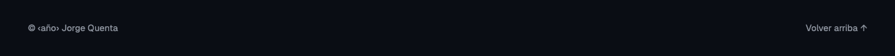 | 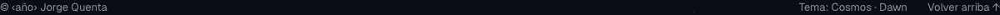 |
| Portada · 834 | 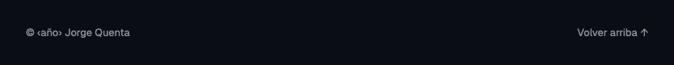 | 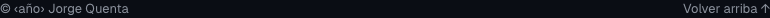 |
| Portada · 390 | 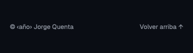 |  |
| Artículo · 1280 | 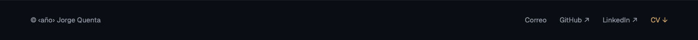 | 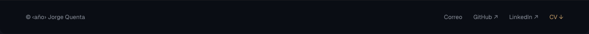 |
| Artículo · 834 | 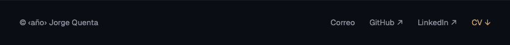 |  |
| Artículo · 390 | 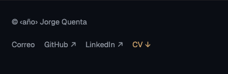 |  |

Movimiento reducido: [barra fija](sitio-fija-390-reduce.png) y [menú](sitio-menu-390-reduce.png). A 360 px se comprueban ambos tipos de página y el menú mediante e2e.

Diferencias previstas por el encargo: sin Notas ni control de tema en portada; Contacto pasa a 06; selector y progreso de artículo vacíos hasta F3; contenido de hero y secciones reservado. Los números inactivos del menú usan `--muted`, pues el oro queda reservado a acción, activo y foco. En tablet se aplican los márgenes de 32 px de TOKENS.md, por encima de los 40 px que dibuja el hero importado por la Maqueta 1. Los enlaces del pie móvil conservan áreas táctiles de 44 px, aunque la maqueta los representa solo como texto.

Para regenerar, después de `npm run build`:

```sh
PLAYWRIGHT_BROWSERS_PATH=.cache/ms-playwright node scripts/capturar-f1.mjs
```

El script sirve `dist/` en 4321 y las referencias con `python3 -m http.server` en 4322; cierra sus servidores al terminar. También comprueba «Volver arriba» y su foco en los tres anchos.
